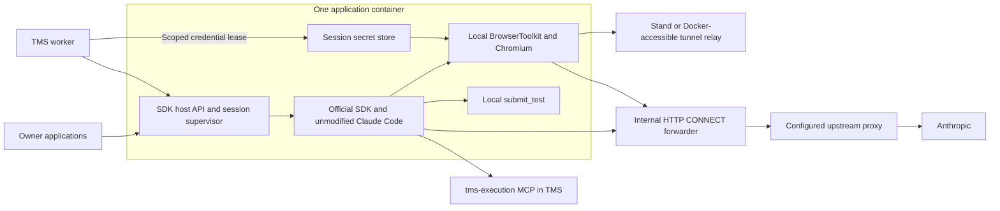

# Personal Claude Agent SDK host

Status: implementation approved by the owner on 2026-10-27. Production deployment requires separate readiness checks and authorization.
Date: 2026-10-27. Owner requirement: personal Claude subscription through the official Agent SDK; personal applications only.
Revision 3 (implementation reconciliation): SDK, Chromium and trusted browser tools share the executor container. Revised after the owner's browser-locality feedback and [the prior-art review](2026-10-27-claude-sdk-prior-art.md).

## 1. Outcome and boundaries

Provide one private service for the owner's applications:

- OpenAI-shaped text completion responses, including streaming.
- Isolated Claude Agent SDK sessions with project-supplied MCP endpoints and session-bound credentials.
- Usage events during execution, cancellation, deadlines and resource limits.
- All connections outside explicitly attached Docker networks through the configured upstream proxy. Proxy failure must never enable direct Internet access.

TMS owns its jobs, permissions, stand leases, permanent encrypted stand credentials, evidence storage, retries, repository and deterministic test runners. The executor owns Claude authentication, SDK subprocesses, browser sessions, trusted browser tools and transport. It receives only the selected stand secrets for a session, keeps them in trusted tool memory and never places them in model messages or the CLI environment. Repair is composition of existing TMS stages, not another model or a new autonomous host workflow.

Do not expose a public inference service, add user registration, redistribute the subscription, replace TMS orchestration, or introduce Kubernetes, Redis or a second business database for this service.

## 2. Evidence and provenance

Read the TMS tree at `f258ba7a` in `/Users/ivanakimkin/Projects/ai-testcase-generator`, not the moving local master (observed `23c3d2b0`). Relative paths below start at `test_importer_web/backend/`:

| Source | Observed behavior relevant to the boundary |
| --- | --- |
| `src/tms/agents/jobs.py` | Job creates run token and stand access; watchdog and terminalization stay in TMS. |
| `src/tms/agents/sdk_runner/runner.py` | One query/session per run, strict tool allowlist, five execution tools, nine browser tools, no built-ins, isolated temporary directory. |
| `src/tms/agents/sdk_runner/browser_tools.py` | Framework-neutral `BrowserToolkit.call`; secret typing and redaction depend on `StandRunnerAccess`; evidence bypasses the model. |
| `src/tms/agents/sdk_runner/usage.py`, `accounting.py` | Deduplication by message ID; agent budget includes input + cache writes + output, excludes cache reads. Usage increments TMS run state. |
| `src/services/ai/claude_sdk_client.py` | Generation already uses one tool-free SDK turn; history is serialized into a user prompt. Completion usage includes cache reads. |
| `src/services/ai/ai_service.py` | Existing OpenAI client sends `temperature=0.7`; migration must explicitly remove it for the SDK endpoint. |
| `src/tms/projects/stands/service.py` | Decrypted stand secrets and keyring stay in TMS; a stand credential key alone cannot give a remote host browser access. |
| `track/21-sdk-test-author`, observed `394997df` | Inspected `sdk_author/author.py` and `authoring/worker.py`; author opens one session per case attempt, submits source, returns usage; three verification runs and up to three authoring attempts belong to TMS. This branch is moving and must be rechecked at implementation. |

Read-only server check on 2026-10-27:

- Deployed TMS backend/worker/runner images are tagged `tms-f258ba7a`.
- Worker has `claude-agent-sdk==0.2.174`. Use this as a compatibility baseline, then pin the tested SDK and bundled CLI together by image digest.
- `ai-testcase-generator_testcase_network`: `172.30.0.0/16`, `internal=false`; `my_server_proxy_network`: `172.19.0.0/16`, `internal=false`.
- These existing networks permit external routing; joining them alone does not enforce a proxy.
- About 31 GiB RAM total, 17 GiB available and 183 GiB disk available at inspection. This supports a small initial host, not an unmeasured concurrency promise.

No server configuration was changed. No credential values belong in this design or its examples.

## 3. Approaches and recommendation

| Approach | Benefit | Cost and reason for decision |
| --- | --- | --- |
| SDK, trusted tools and Chromium in one executor | One place to launch, limit and cancel the session; one network policy covers SDK and browser | Requires a scoped credential handoff and verified Docker access to tunnel relays. Recommended after owner feedback and source review. |
| Generic SDK host; browser and tool gateway in TMS | Preserves stand locality without transferring credential values | Requires a new browser MCP service and distributed lifecycle. Earlier draft recommendation, superseded; no such service exists today. |
| Keep SDK in every application | Lowest immediate migration effort | Duplicates subscription credentials, egress enforcement and process management. Does not provide the requested common host. Reject. |

The owner indicated preference for the unified executor and requested prior-art research before proceeding. The owner subsequently approved implementation; the concrete request contract is maintained in `claude-sdk-host/API.md`. Anthropic's hosting cookbook supplies the HTTP/SSE/container precedent; Browser Use and Playwright supply secret-placeholder and session-isolation precedents. No inspected project supplies the entire TMS-specific service.

The deployable unit has one application container containing SDK and Chromium, plus small network sidecars. A literal single container with only proxy environment variables does not meet the egress guarantee. Use existing proxy software and kernel policy, not an application-written forwarder or another full agent framework.

## 4. Topology



Host, TMS endpoints and applications communicate on dedicated Docker networks. Namespace firewall rules cover the supervisor, every SDK child, Playwright and Chromium. The browser is inside the same enforcement boundary as the SDK.

## 5. Container and network design

### Services

| Service | Responsibility | Authority |
| --- | --- | --- |
| `claude-sdk-host` | Python 3.12, FastAPI, supervisor, official Python Agent SDK/CLI, Playwright/Chromium and existing narrow browser tools | Non-root; capabilities dropped; no Docker socket, host network, repository mount or TMS master decryption key. Session secrets are in trusted worker memory only. |
| `sdk-netguard` | Owns the host's network namespace and installs an atomic nftables ruleset before becoming healthy | One of two guards receiving `NET_ADMIN`; no application API and no inference credentials. |
| `sdk-egress-guard` | Owns the forwarder namespace and restricts uplink to configured numeric parent IPs/ports | The second small `NET_ADMIN` guard; no inference or application credentials. |
| `sdk-egress` | Existing proxy software with mandatory upstream chaining: compatible pinned Squid for HTTP upstream, or GOST when SOCKS conversion is needed | Upstream credential from a secret file; no direct-destination egress. Do not add both products unless required. |

The host uses `network_mode: service:sdk-netguard`; networks and any optional loopback port publication belong to netguard. No external port is published by default. Application clients use `http://claude-sdk-host:8080/v1` through the netguard network alias. Other machines use an authenticated private route or SSH tunnel.

Use new, non-overlapping IPAM subnets chosen after checking host routes and Docker networks:

- `sdk_clients`, internal: only approved application backends/workers and netguard.
- `sdk_tools`, internal: netguard, registered TMS execution MCP/credential endpoints, and scoped stand/tunnel relays. No general host access to the TMS database/storage network is required.
- `sdk_proxy`, internal: netguard and egress forwarder, with fixed private IPs.
- Forwarder's separate uplink: permits connections only to configured upstream proxy IPs/ports. Forwarder must not become a generic router between its networks.

External networks must be declared and provisioned across the two Compose projects. Adding TMS to these networks is an explicit implementation step, not assumed present today.

### Fail-closed policy

Apply IPv4 and IPv6 rules inside the namespace; allow established replies and necessary loopback traffic, then permit only:

1. Incoming API connections from approved client networks and their replies.
2. Outgoing TCP to registered MCP, credential and stand/relay endpoint IPs/ports on attached Docker networks.
3. Outgoing TCP to the forwarder's fixed Docker IP/port.

Drop everything else, including direct `:443`, external/private non-Docker addresses, host gateways, metadata endpoints, UDP/QUIC and unneeded IPv6. Do not exempt all RFC1918 space, all `172.16.0.0/12`, arbitrary future Docker networks or `host.docker.internal`. Localhost exception is for in-container IPC and does not create a host route.

The policy is stricter than the owner's Docker-network exception: only required internal peers/ports are reachable. There is no need to connect the host to every Docker network.

Host name resolution in version 1 uses deployment-generated static mappings for `sdk-egress` and registered internal MCP service names. These peers get stable addresses on the new networks; recreate the host if mappings change. Disable direct DNS from the SDK namespace, including Docker's `127.0.0.11` external forwarding path; this rule precedes the general loopback allowance. External hostnames are passed to the HTTP CONNECT forwarder and resolved through the upstream proxy. This avoids pretending that Docker DNS forwarding is covered by HTTP proxy variables.

Forwarder bootstrap uses configured upstream IPs, or a separately controlled resolution step on the host; any resolution happens before the SDK starts. A SOCKS upstream must resolve final destination names remotely. Pin multiple upstream IPs if necessary and update the allowlist atomically during maintenance.

Set both uppercase and lowercase `HTTP_PROXY` and `HTTPS_PROXY` to the internal HTTP proxy. `ALL_PROXY` may be supplied for compatible clients, but is not the enforcement mechanism. Claude Code documents HTTP/HTTPS proxy support and no SOCKS support. `NO_PROXY` contains only exact registered internal aliases/IPs and localhost; no `*` and no assumed CIDR portability across clients.

The final upstream proxy address, protocol and secret source are deployment inputs still to be bound. For a compatible Squid release use its parent-proxy configuration and `never_direct` policy; these directives are not available in Squid v8, so pin a tested compatible version. For GOST configure one mandatory chain with no direct/bypass route. Independently restrict the forwarder's uplink to upstream proxy IPs/ports. The existing local GOST listener is not proof of a remote exit route. Verify the actual external IP through the chosen chain. Keep TLS verification enabled; no `NODE_TLS_REJECT_UNAUTHORIZED=0`.

Boot order: install deny rules → validate allowed peers/proxy configuration → mark netguard ready → start host → verify auth and lightweight proxy reachability. Missing rules or upstream configuration keeps readiness false. Netguard restart/recreation requires coordinated host recreation; do not leave an old application attached to an unmanaged namespace. Proxy outage may leave liveness healthy while readiness fails; it never relaxes the firewall.

Image build/pulls run outside the application namespace: configure builder/daemon proxy separately if the same requirement is extended to deployment traffic. Install all runtime dependencies at build time; no runtime package installation or CLI auto-update.

## 6. Authentication and isolation

Use the owner's subscription through official Claude Code sign-in in a maintenance invocation of the same pinned image. The owner completes Anthropic's login flow. Persist only the authentication state needed by that official CLI in a dedicated server volume with restricted ownership. Do not copy a developer's whole `~/.claude`, scrape tokens, build an OAuth frontend or send subscription tokens to application clients. Do not set an API key or configure an automatic paid API fallback.

Separate this credential volume from per-session temporary directories and disable conversation persistence. The official CLI may need writable credential state to refresh its login; a universally read-only auth mount must not be assumed. Pin and verify refresh behavior, including two child processes, before enabling concurrency above one. Authentication loss returns `reauthentication_required` and queues no indefinite retries.

The host's private Bearer tokens identify applications, not Claude credentials. Each application token maps server-side to an allowed owner subject, registered MCP endpoints, model aliases and operation scopes (`completion`, `session:create`, `session:read`, `session:cancel`). The host does not trust an arbitrary `requested_by` field from the body. TMS additionally authorizes the real run/job creator against `LLM_SDK_ALLOWED_USERS` before opening browser resources or an SDK session. Granting an application a host key must not grant other TMS users access to the subscription.

All SDK children start with a constructed environment allowlist, not a copy of the supervisor environment. Keep only required runtime paths/locales, official auth configuration and fixed proxy values. Never accept `env`, shell commands, arbitrary CLI flags, `cwd`, authentication changes or settings files from a session request.

Each agent session gets a new worker process, SDK child, empty temporary workdir, trusted secret store and fresh Chromium/context. Completion workers do not instantiate a browser or credential store. Host filesystem is read-only except auth state and bounded tmpfs. Set init, `no-new-privileges`, PID/memory/CPU limits and core dump limits. These are process isolation measures; sessions sharing one container UID are not a strong hostile-tenant sandbox. Only owner-controlled application backends are admitted.

Preserve Chromium's own sandbox: run it as a non-root user with a compatible seccomp/user-namespace configuration, explicit `chromium_sandbox=True` where required by the Playwright API, and adequate private shared memory. Verify the actual sandbox launch on this server; do not silently fall back to `--no-sandbox`, host IPC, `SYS_ADMIN` or privileged mode. Browser/runtime/package versions must match. General-purpose nested `sandbox-runtime` is not a first-version dependency: its namespace restrictions can conflict with Chromium's own sandbox, while the outer container policy already supplies the required network boundary.

## 7. Completion contract

Offer `GET /v1/models`, `GET /v1/capabilities`, `POST /v1/chat/completions` and `POST /v1/completions` (string prompt, one result). Both completion routes use a fresh official SDK query with `max_turns=1`, no MCP servers and no tools. They never turn generation into an agent task.

Version 1 accepts text messages with `system`, `user`, `assistant` roles; `model`; `stream`; `n=1`; and `stream_options.include_usage`. Preserve role order in a deterministic escaped transcript, with system content supplied separately as the whole system prompt. This follows the existing TMS adapter but is an approximation of chat-message semantics, not a direct Messages API implementation. Do not accept tool-result roles or silently flatten multimodal content.

Example request:

```json
{
  "model": "claude-personal-default",
  "messages": [{"role": "user", "content": "Write three test cases for password reset."}],
  "stream": true,
  "stream_options": {"include_usage": true}
}
```

Model aliases resolve to deployment-pinned supported Claude model IDs; no fabricated hardcoded current-model list. Capabilities enumerate supported request fields, limits and aliases.

Return OpenAI-shaped `chat.completion` / `chat.completion.chunk` or legacy text completion objects, stable request IDs, `choices`, text and finish reason. Streaming uses SSE `data:` frames, an optional final usage-only chunk and `[DONE]`. Enable SDK partial messages and forward text deltas once; do not emit the same text again from `AssistantMessage` or `ResultMessage`.

Unsupported request fields return HTTP 400 with `error.type=invalid_request_error` and `error.code=unsupported_parameter`, without echoing rejected values. In particular, do not silently accept `temperature`, `top_p`, `logprobs`, multiple choices, caller-defined tools, stop strings or exact `max_tokens` semantics. SDK options do not provide direct equivalents. Exact response-format/JSON-schema support can be added only after a pinned-version contract check; version 1 rejects it. Update the TMS OpenAI adapter to omit its current `temperature=0.7` for this endpoint. Other personal applications must consult this capability subset.

Completion `prompt_tokens` includes input, cache creation and cache reads; `completion_tokens` is output; `total_tokens` is their sum. Preserve the raw breakdown in host accounting. On an incomplete/crashed query, unknown usage is null/incomplete, never a fabricated zero. Do not claim that token totals equal Claude subscription quota usage or that estimated dollar cost is a bill.

Before streaming starts: invalid caller 401/403; saturation or known subscription exhaustion 429 with retry information when available; proxy/provider unavailable 503; deadline 504. After headers: emit a structured error frame and close; never emit successful terminal content after a provider error. Client disconnect cancels the child. No automatic full-query replay after any output has been emitted. Completion deadline is 300 seconds by default, configurable per application within an operator cap.

## 8. Agent session contract

| Route | Contract |
| --- | --- |
| `POST /v1/agent-sessions` | Validate app/owner, registered MCP endpoints, explicit tool allowlist and budgets; return 202 with host session ID, state and event URL. |
| `GET /v1/agent-sessions/{id}` | App-scoped status, stop reason, usage totals, last sequence and accounting completeness; never return credentials or the original payload. |
| `GET /v1/agent-sessions/{id}/events` | App-authenticated SSE with ordered event IDs and `Last-Event-ID` replay. |
| `POST /v1/agent-sessions/{id}/ack` | Acknowledge the highest durably applied event sequence and renew the consumer lease. |
| `POST /v1/agent-sessions/{id}/cancel` | Idempotently request cancellation; return current state; completion is confirmed by terminal state/event. |

Concrete request fields: `client_request_id`, `profile`, `model`, `system_prompt`, `prompt`, `mcp_servers`, `timeout_seconds`, `token_budget`, `max_turns`, and `browser` with `origin`, `credential_key`, `credential_provider`, `credential_lease`. Each MCP entry contains its registered `name`, exact `url`, session `token` and explicit `tools`; version 1 exposes exactly the five TMS execution tools. Authoring adds `source_contract` with `file_path`, `global_case_id`, `credential_key`, and no remote MCP servers. The complete schema and examples are in [the API contract](../../../claude-sdk-host/API.md). No inline stand secret values belong in prompts. Expiry is fixed at acceptance from `timeout_seconds`, including queue wait. TMS sends only remaining job time. Repeat the original identical body for idempotent creation; generating a new lease changes the HMAC fingerprint and correctly conflicts. No automatic query replay is permitted after restart. Operator session caps are advertised through capabilities; the default time cap is 14,400 seconds to support existing TMS author jobs up to 240 minutes. Larger jobs need an explicit configured cap, up to 604,800 seconds.

Each project-supplied MCP entry has a logical name, a URL registered for that application and an ephemeral Authorization header. Accept streamable HTTP only; reject caller-supplied stdio transports, localhost/metadata/host-gateway destinations and unregistered URLs. The host itself registers its trusted in-process SDK browser/submission tools; this does not authorize arbitrary client-supplied executable servers. Validate scheme, host, port and path, refuse HTTP redirects, and do not forward credentials to another origin. Internal HTTP is permitted on the isolated Docker tool network; remote endpoints require HTTPS and proxy support verified for the pinned CLI. Credential transfer separately requires authenticated TLS even internally. Internal peers are fixed/mapped, eliminating DNS rebinding in the initial deployment. Never log headers or include them in model prompts.

For every session set `tools=[]`, `strict_mcp_config=True`, `setting_sources=[]`, `permission_mode=dontAsk`, `verbatim_prompts=True`, an explicit built-in denylist, and `no-session-persistence`. Use an exact MCP tool allowlist and a pre-tool check to reject any unlisted name; `dontAsk` alone is not the tool boundary. Reject profiles that try to enable shell, files, subagents, skills or web tools.

Profiles are policies, not independent orchestration engines:

- `tms-execution`: five `tms-execution` model tools plus nine browser tools; one session per run; cap 1500 turns; example 2,000,000 budget tokens and 30 minutes. Ten minutes per point remains a TMS prompt/domain rule. Actual run budgets are supplied by TMS, not silently replaced by examples.
- `tms-authoring`: browser inspection tools and exactly one successful `submit_test`; one session per case attempt. The TMS job passes its remaining part of the 1,000,000-token / 20-minute defaults across every case and retry. The host must not reset these job-wide budgets per session.
- Repair invokes execution and then authoring from TMS only when the case passes. No repair implementation is claimed by this design.

States: `queued → starting → running → completed|failed|cancelled|timed_out|budget_exceeded|consumer_lost|interrupted`. Cancellation before dequeue starts no SDK child. A completed SDK query is host-level completion, not proof that all TMS cases passed; TMS derives domain status from its MCP records. An authoring submission is typed output from the trusted local `submit_test` tool, not the model's final prose; TMS validates it again before running or saving it. A validated submission received before a later provider failure may still be checked by TMS under its current authoring rules.

## 9. TMS adapters, local tools and credential handoff

No browser MCP service is added to TMS. Extract the existing framework-neutral `BrowserToolkit` and its narrow stand-access interface into a versioned package consumed by the executor. Do not import the whole TMS backend, database configuration or keyring into the image. Implement the access interface using a session-only dictionary so `type_named_value`, `redact_text` and `contains_sensitive` retain their semantics. This is reuse of existing tool code, not another browser agent loop.

After creator authorization, TMS issues an opaque credential lease bound to application, owner, project, run/job, attempt, stand origin and selected credential key. New internal credential-provider routes are required: create/revoke the lease inside TMS and redeem it over authenticated HTTPS from the executor. Only registered provider endpoints are accepted; the caller cannot supply a fetch URL. Lease redemption expires after at most 60 seconds and is single-use. Mint it immediately before submitting the session; the 30-second host queue bound fits within that interval. TMS checks that the job and stand lease remain active at redemption, decrypts only the selected credential set and returns LOGIN/PASSWORD/extra named values with the session's expiry. Other credential sets and the master key are not exported. If startup consumes the lease then fails, terminate the session; TMS creates an explicitly new attempt/lease instead of replaying redemption.

Host-to-provider requests authenticate the host application identity as well as the opaque lease, verify the registered certificate, refuse redirects, and log no token/body. Redemption returns a non-secret grant ID for a new host-authenticated status route; the single-use token is not needed again. TMS retains redeemed grant state until the session expires. Before every local browser/submission tool, the worker checks that grant's active job/stand state; failure, revocation or an unreachable provider denies the action and stops the session. A 5-second watchdog also checks while the model is running. TMS sends best-effort host cancellation on revocation; an already-running browser action may finish before cancellation, so revocation is not a rollback guarantee.

Hold returned values only in the trusted session worker; pass neither values nor the credential-lease token into the SDK child environment or prompt. The tool layer checks exact stand origin before secret entry and redacts every result. Local expiry and consumer/deadline cancellation prevent further tools; worker exit releases the store. Process memory removal is lifecycle cleanup, not a promise of cryptographic zeroization in Python. Any tokens/cookies produced by login are also session secrets and must not be journaled.

Execution connects to the existing `tms-execution` MCP using `Authorization: PrivateToken <run-bound token>`. Its SDK-side adapter registers the local browser toolkit. The model sees only the five execution tools plus the nine browser tools. The local evidence sink holds the run capability and calls hidden `attach_evidence` itself. The model never handles screenshot bytes or an evidence-upload token.

Authoring gets case snapshot/specification, global case ID, target path, recorded pass steps and redacted previous source/error. A local `submit_test` tool validates one TypeScript source using extracted pure submission rules and the session's known-secret checks. It returns structured source plus usage to the TMS adapter. Duplicate identical submission is idempotent; a different second source is refused. Source must use `STAND_URL` and `STAND_<KEY>_*`; no credentials or credential fallbacks. TMS performs its own authoritative source validation before all deterministic checks, persistence and retry preparation. No test source executes inside the SDK host.

Retain redaction for every browser tool result, secret typing by name and refusal when sensitive content is detected. Existing PNG byte matching is not a proof that rendered text contains no secret: retain field masking and keep images away from the model; any stronger screenshot guarantee needs its own rendering/masking design. Do not advertise a stronger guarantee merely by moving the transport.

The browser now runs in the executor, so startup must include real reachability from that container to the exact stand/relay. Reading a connected tunnel flag or sharing a Docker network is not a TCP reachability check. TMS supplies a Docker-reachable tunnel endpoint; for loopback-only tunnels add a scoped relay accessible on `sdk_tools`, without host networking. Register both the logical stand origin and transport endpoint where relay addressing differs; do not silently change redirects, cookie domains, Host headers or TLS checks. Verify a real login flow through the relay before acceptance.

SDK and Chromium share the namespace firewall. Also explicitly configure Playwright's HTTP proxy/bypass: internal stand/relay directly; external stand, subresources and WebSockets through the configured proxy; no direct DNS/UDP fallback. Test the `route.fetch` path as well as ordinary page traffic. Current origin checks cover document navigation and allow non-navigation requests; do not reinterpret them as a complete egress policy or silently block required CDN resources. This preserves navigation behavior while enforcing the proxy for external browser requests too. Existing deterministic test runners remain separate from this host.

Migration touches only adapter seams in TMS: `get_runner()` returns a remote session runner; `get_test_author()` returns a remote author; creator guards remain; generation switches to the OpenAI-shaped endpoint and supported fields; existing MCP handlers and deterministic checks stay. Once accepted and deployed, remove Claude credentials from the TMS environment. Do not leave a direct-SDK fallback that bypasses the host or its limits.

## 10. Usage, budgets and delivery

Event envelope: `session_id`, monotonic `seq`, `event_id`, UTC timestamp, `type`, data. Types include `started`, `text_delta`, `submission`, `usage`, `usage_reconciled`, `rate_limit`, `terminal`. Do not relay raw SDK debug logs, hidden thinking, MCP headers or tool payloads into this event journal; the typed source submission is an explicitly authorized live result with the memory-only handling below.

Use one canonical meter, keyed by provider message ID, covering both partial stream events and complete assistant messages without counting the same turn twice. Maintain per-field maximum observations; emit only positive differences. Preserve `input_tokens`, `cache_creation_input_tokens`, `cache_read_input_tokens`, `output_tokens`, and whether each observation is provisional/final. A new message ID is a new model turn, not another block of the same response.

Current official docs warn that per-assistant `output_tokens` can be a placeholder. Enable partial messages; validate whether `message_delta.usage` on the pinned SDK supplies authoritative cumulative output for each model response. Reconcile with the final `ResultMessage`; emit only previously unreported increments. Never add a final session total to already-counted turns. Version 1 has no subagents or resumed model sessions, avoiding their different usage scopes.

Release gate: a real two-tool-turn session must produce usable output accounting during execution. If the pinned version cannot do that, do not certify a hard token budget from placeholder values or silently degrade to final-only accounting. Record the incompatibility and revise the version/transport before rollout. A token limit remains observed enforcement: stop before another turn once observed spend reaches it; the current in-flight provider response may overshoot. Do not promise an exact pre-billing token ceiling.

TMS agent budget remains `input + cache_creation + output`, excluding cache reads. OpenAI-shaped completion accounting includes cache reads. Send raw values and the explicit agent budget total so these different conventions are not accidentally unified. An authoring terminal `AuthoringOutput` settles already-streamed usage; it is not an additional charge. TMS must deduplicate persisted increments by `(host_session_id, event_id)` in the same transaction as the run/job counter update; the existing additive callback alone is not safe for replay.

TMS watchdog stays authoritative for its domain state. Host also enforces remaining tokens, monotonic wall-clock deadline, max turns, caller cancellation and consumer lease. After a budget stop, no new model turn or tool action starts. Interrupt the SDK, close MCP transport and Chromium, revoke the TMS credential lease and terminate the whole worker/child process group after at most 5 seconds. TMS terminalization sweeps unfinished points as today.

Persist host metadata and usage/terminal events in a small SQLite WAL database on a dedicated volume. Do not persist prompts, tool credentials, raw source or text deltas. Write usage/terminal events before sending them. Retain acknowledged accounting records for 7 days; retain unacknowledged records until acknowledged or explicit operator cleanup. Cap metadata/journal storage at 256 MiB and refuse new sessions when full rather than deleting unacknowledged accounting. TMS acknowledges after database commit; unacknowledged events replay after reconnect. Text deltas are live-only and explicitly not replayable; domain results live in TMS.

Consumer lease: acknowledge/renew every 5 seconds; if no renewal for 30 seconds, stop further work as `consumer_lost`. Reconnect within that interval replays usage and resumes observation of the same process, never launches a duplicate query. Completion connections instead cancel on disconnect. TMS must handle usage after cancellation until the terminal event. Authoring adds a typed `submission` event: keep at most one accepted source in bounded memory (60,000 characters) until acknowledged, replayable to that application on reconnect for up to 30 seconds after terminal delivery. TMS commits source and usage before acknowledging. Raw source is never written to the host journal; after host restart or expiry of this result buffer report `result_unavailable` explicitly, and TMS may start a new authoring attempt under its remaining budget. Do not replay the old model query automatically or treat a source-less terminal record as successful authoring.

Host restart marks every nonterminal session `interrupted`; no automatic resumption or replay of side-effecting tools. Revoke/expire TMS credential leases. All Chromium/CLI processes belong to the executor's init/supervised process tree; session worker failure triggers cleanup, and container stop kills remaining processes. Usage already journaled remains available. Provider work whose final counters were lost is marked `accounting_complete=false`; never invent a complete total after a hard crash. Idempotency records prevent duplicate start requests across restarts. Completed authoring metadata survives, but an unacknowledged source held only in memory does not: expose its unavailable result as above.

## 11. Capacity and operations

Initial operator defaults: one active agent session and one completion, with at most two SDK children globally; separate FIFO queues (8 agent requests, 16 completions). Start production at a global concurrency of one until official credential refresh and rate-limit tests pass. A request waits at most 30 seconds in queue and never beyond its acceptance-relative expiry. A full queue returns 429 before acceptance; an accepted session that cannot start within the queue wait ends as `timed_out` with `queue_timeout`, and one whose deadline arrives first ends as `timed_out`. Queue time consumes the remaining TMS time budget; no admission reservation or clock extension is implied. Apply fair selection across the two queues so a completion backlog cannot starve agent jobs.

Executor initial resource allowance: 2 CPUs, 4 GiB RAM, 512 PIDs, 512 MiB private shared memory and 256 MiB bounded work tmpfs. These are starting values to measure with Chromium included, not measured requirements. Keep one browser-bearing session active initially. Shared subscription rate limits affect both queues; respect provider resets, return bounded retry advice, never rotate accounts or retry indefinitely. No persistent broker is needed.

`/health/live` checks supervisor health. `/health/ready` checks namespace policy readiness, proxy reachability, available storage and presence of official auth state; it does not certify token validity or paid inference. It must not consume model tokens per health probe. A maintenance smoke exercises actual authentication. `/metrics` requires application authorization with `session:read` and exports that application's session states, durations, usage categories and active/queued child counts without prompt/header labels. Safe terminal reasons remain in session status; live inference/parent-exit checks are separate maintenance gates.

Deploy pinned application/proxy images manually first; do not put an active session host under unconditional Watchtower restarts. Drain queues, wait for sessions or cancel them explicitly, then recreate the complete namespace unit. Keep version metadata for SDK, CLI, host and tool protocol in every diagnostic status.

## 12. Verification required before implementation is accepted

This is a manual/integration checklist for an infrastructure/API service (`ui=false`); no browser regression suite is created for the host itself. Explicitly requested network and contract verification is part of later implementation, not a claim about tests run for this document.

| ID | Assertion and evidence |
| --- | --- |
| NET-01 | External request succeeds only with the proxy; upstream-observed IP matches the intended exit. SDK API, auth refresh and external MCP use the chain. |
| NET-02 | Disable proxy variables in a child; direct IPv4/IPv6 TCP, UDP/QUIC, private non-Docker, host gateway and metadata access fail. Verify packet capture/counters outside the namespace. |
| NET-03 | External DNS to UDP/TCP 53, DoT and Docker DNS forwarding fails; permitted static internal names work. HTTPS DNS can only leave through the proxy. |
| NET-04 | Stop upstream, stop forwarder, restart netguard, recreate the unit and kill an SDK child: no direct fallback, no startup race or unmanaged surviving process. |
| MCP-01 | Correct run/attempt tokens work; wrong/expired/cross-project tokens and arbitrary URLs/redirects fail. Hidden evidence tool, shell and undeclared tools remain inaccessible. |
| TMS-01 | A real execution run reaches a direct stand and a tunnel stand, records steps/evidence and streams usage to the correct run. Denied creator opens no browser/SDK. |
| TMS-02 | One author attempt inspects live UI and submits one source with environment placeholders. Three checks run in the TMS runner; retries share job budgets. |
| SEC-01 | Known canary credentials typed by name do not appear in tool text, prompts, source, events, logs or retained data; screenshots mask known secret fields. Wrong-origin/cross-run/expired/replayed credential leases are rejected; master key and other credential sets never enter the executor. |
| BROWSER-01 | External document, subresource, WebSocket and `route.fetch` traffic use the proxy; internal stand/tunnel remains direct; proxy outage has no direct bypass. |
| USE-01 | Multi-block same-ID messages, raw deltas, final reconciliation and SSE replay do not double-count. A real multi-turn call updates input/output usage before session end. Cache policies match the two contracts. |
| STOP-01 | Token/time/turn stop, lost consumer, TMS job lease loss, disconnect and explicit cancellation stop worker/CLI/Chromium process groups and revoke credential leases. |
| REC-01 | Restart mid-run produces `interrupted`, recoverable usage and no duplicate side effects; incomplete accounting is visible. Author source reconnect/ack works while buffered; restart before source acknowledgement exposes `result_unavailable`. |
| API-01 | Streaming/nonstream chat and prompt routes work in actual application OpenAI clients; role history is serialized once; unsupported fields receive 400, provider failure is not a successful empty response. |
| AUTH-01 | Official personal login, refresh and two-child behavior work through the proxy without leaking credentials; expiry requests owner reauthentication. |
| SANDBOX-01 | Chromium starts non-root with its own sandbox enabled; no privileged mode, host IPC or Docker socket is needed. |

No model calls, builds, egress enforcement tests or deployments have been performed in this design task.

## 13. Decision ledger and remaining deployment inputs

| Decision | Basis and likely cost to change |
| --- | --- |
| Personal subscription via official Agent SDK | Explicit owner answer. API-key billing would require a new auth/backend decision. |
| SDK/browser/trusted tools in one executor; permanent credentials stay in TMS | Owner feedback plus prior-art review supersedes the initial split-browser draft. Requires a scoped credential lease and tunnel relay contract; moving the browser back would reintroduce remote tool/lifecycle management. |
| Generic session API plus limited OpenAI-shaped completion API | Reuses one SDK runtime across personal apps. Full OpenAI semantics are not promised and would require a different backend or expanded verified adapters. |
| Network enforcement outside unprivileged app | Required by all-external-traffic proxy rule. Removing sidecars would need equivalent host-managed namespace policy. |
| Existing Squid or GOST proxy, no custom proxy implementation | Reuse documented upstream-chaining behavior; choose based on actual upstream protocol and pin compatible syntax/version. |
| Static internal peer mapping in first version | Avoids DNS leakage and rebinding. Dynamic discovery later requires an internal-only DNS policy and lifecycle handling. |
| Durable usage, no persistent conversation state | TMS owns results; restart does not replay side effects. Durable model resumption would be a new protocol and accounting change. |

Bind during implementation preflight: actual upstream proxy/protocol/IPs and secret-file location; new subnet ranges and registered application endpoints; credential-provider endpoint/certificate and versioned shared toolkit; Docker-reachable stand/tunnel relay contract; official auth-volume lifecycle; pinned image/model IDs. Discover these through repository/server checks where possible. If a loopback-only tunnel needs a relay, implement and verify that relay as part of TMS integration rather than broadening the SDK network policy.

The first draft's independent read-only review found a queue/deadline contradiction, resolved by counting queue time against the supplied deadline. Revision 2's independent read-only builder check identified the missing active-grant revocation channel; section 9 now specifies pre-tool status checks, fail-closed handling and a 5-second watchdog, including the in-flight action limitation. The reviewer reread that resolution and reported no blocking findings. Neither review substitutes for the measured release checks, which remain unperformed.

## 14. Official references checked 2026-10-27

- [Agent SDK overview](https://code.claude.com/docs/en/agent-sdk/overview): SDK runs the official Claude Code binary; product/auth distinctions.
- [Using the Agent SDK with a Claude plan](https://support.claude.com/en/articles/15036540-use-the-claude-agent-sdk-with-your-claude-plan): current subscription usage notice. This does not by itself certify any arbitrary redistribution arrangement.
- [Authentication](https://code.claude.com/docs/en/authentication) and [legal and compliance](https://code.claude.com/docs/en/legal-and-compliance): official sign-in and individual-use/credential boundaries. This design serves only the owner's stated personal use.
- [Network configuration](https://code.claude.com/docs/en/network-config): HTTP/HTTPS proxy variables and lack of SOCKS proxy support in Claude Code.
- [Configure your agent](https://code.claude.com/docs/en/agent-sdk/configuration) and [Python reference](https://code.claude.com/docs/en/agent-sdk/python): SDK controls and request-option limitations.
- [Streaming output](https://code.claude.com/docs/en/agent-sdk/streaming-output): raw events, message boundaries and partial-message option.
- [Usage tracking](https://code.claude.com/docs/en/agent-sdk/cost-tracking): deduplication and provisional per-step output counts. Pin and smoke-test actual installed behavior rather than relying only on the prose docs.
- [Docker networking](https://docs.docker.com/engine/network/), [bridge networks](https://docs.docker.com/engine/network/drivers/bridge/) and [firewall behavior](https://docs.docker.com/engine/network/firewall-iptables/): ordinary bridges provide external routing; network namespace DNS needs explicit treatment.
- [Playwright network/proxy configuration](https://playwright.dev/python/docs/network#http-proxy): explicit browser proxy settings are separate from the SDK's environment.
- [Prior-art review](2026-10-27-claude-sdk-prior-art.md): inspected Anthropic hosting code, Docker Sandboxes, Browser Use, Playwright MCP, OpenHands, an OpenAI wrapper and existing proxy software, including source-specific limitations.


## Implementation reconciliation evidence

The four-service guard layout additionally fences GOST itself; a local probe demonstrated that the forwarder can reach only its configured parent. The original Playwright seccomp profile is retained unchanged, with a separately documented derived profile allowing only the additional `chroot` syscall needed inside Chromium's user namespace when all initial capabilities are dropped. No new Linux capability, privileged mode or sandbox disable flag is granted. The application uses a digest-pinned official Python base with the matching Playwright/Chromium installed at build time. Real sandbox startup, Basic-origin binding and known secret echo refusal were reproduced locally. See the status ledger for exact acceptance boundaries and remaining live deployment checks.
