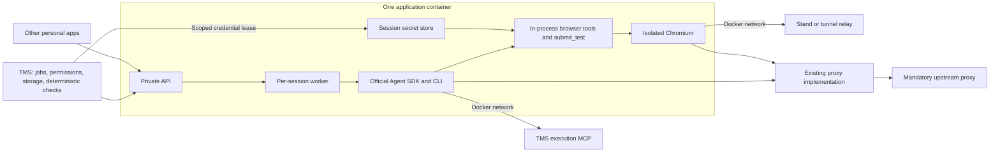

# Prior art for the personal Claude SDK executor

Research date: 2026-10-27. Scope: official documentation and first-party project source, with one directly relevant community API wrapper. This is a source review, not a deployment benchmark or a claim of market-wide adoption.

## Conclusion

Use a persistent private HTTP service that supervises independent SDK subprocesses and local browser sessions, with network egress enforced outside the application. Keep TMS as the job/result authority. Transfer only the required stand credential set to trusted session tools, not to model messages or subprocess environment variables.

No inspected project supplies the complete TMS contract: its five execution MCP tools, named secret typing, hidden evidence upload, per-turn usage budget and source-authoring attempts. The useful precedent is a combination of established components, rather than adopting another full agent framework.

## 1. Anthropic hosting cookbook: the closest starting point

Sources: [hosting tutorial](https://platform.claude.com/cookbook/claude-agent-sdk-07-hosting-the-agent), [hosting source directory](https://github.com/anthropics/claude-cookbooks/tree/main/claude_agent_sdk/hosting), [server.py](https://github.com/anthropics/claude-cookbooks/blob/main/claude_agent_sdk/hosting/server.py), [Dockerfile](https://github.com/anthropics/claude-cookbooks/blob/main/claude_agent_sdk/hosting/Dockerfile).

The tutorial provides Docker, Modal and Kubernetes variants of the same HTTP-hosted agent. Its Docker tier targets internal and single-tenant deployments. The source server uses FastAPI and SSE, and calls the official SDK. This is directly comparable to the requested private host.

Inspected file blob IDs: `server.py` = `bce52742d1387857f4c352abed6e69774d24ab47`; `Dockerfile` = `a6c06a6ec85d9a8405984070db9b92a954434f9b`. Files were retrieved through the GitHub connector; these are blob IDs, not repository commit IDs.

Reuse the packaging and HTTP/SSE arrangement as a reference. Do not deploy the cookbook server unchanged: authentication is opt-in, ownership checks are delegated to a gateway, and it serializes raw SDK events/errors. Its documented persistent/resumable research workflow differs from the TMS's one-session-per-run requirement. Its API-key example is not a subscription-authentication recipe. We need stable filtered events, mandatory application auth and the existing TMS lifecycle.

## 2. Anthropic deployment guide: put enforcement outside the executor

Source: [secure deployment](https://code.claude.com/docs/en/agent-sdk/secure-deployment).

The guide describes hardened containers, constrained outbound connectivity and a proxy outside the agent boundary. It distinguishes permission controls from actual sandboxing. It also describes authenticated custom tools and proxy-side header injection.

Adopt the boundary: application processes cannot remove the network restriction. A proxy variable is configuration, not enforcement. Our Docker-network exception means its literal `--network none` example is not directly usable; attach only required Docker networks and apply an equivalent deny-by-default namespace policy.

Do not transplant API-key injection into personal Claude OAuth. The owner continues using the official CLI sign-in. An HTTP CONNECT proxy cannot substitute an HTML form's password or redact page content; trusted browser tools must handle those operations themselves.

## 3. Docker Sandboxes: a concrete network architecture, not our first deployment target

Sources: [isolation layers](https://docs.docker.com/ai/sandboxes/security/isolation), [upstream proxy](https://docs.docker.com/ai/sandboxes/configuration/upstream-proxy/).

Docker Sandboxes routes sandbox TCP through policy-enforcing proxies and treats DNS and UDP separately. Its upstream proxy setting is distinct from the destination access policy. Upstream support is currently marked experimental, and its defaults can select direct access when no proxy is configured.

Borrow the separation between allowed destinations and the mandatory upstream route, plus explicit DNS/UDP treatment. Do not assume that installing Docker Sandboxes automatically satisfies “no direct fallback.” It introduces a separate sandbox/microVM platform and host-service access model, whereas this deployment already uses ordinary Linux Docker Compose networks. No platform migration is needed to reproduce the relevant network controls.

## 4. Browser Use: domain-bound placeholders for form secrets

Source: [sensitive-data example](https://github.com/browser-use/browser-use/blob/main/examples/features/sensitive_data.py). Inspected blob: `a7b4bf020240fc586b726d909f7517481fff6cde`.

The example associates named secret values with destination domains. The agent uses symbolic names, and browser-side handling performs the substitution. This is close to the existing TMS `type_stand_secret` pattern.

Adopt session-scoped secret names and exact origin binding. Keep the master decryption key in TMS; provide only the session's selected values to its trusted browser runtime. Apply redaction to output and separately handle screenshots and persistent artifacts.

Do not adopt the whole Browser Use agent loop: we already selected Claude Agent SDK, and TMS already has the narrower browser toolkit. The example demonstrates the secret-input pattern; it does not prove that arbitrary page echoes or image pixels cannot disclose a secret.

## 5. Microsoft Playwright MCP: browser isolation and limits of redaction

Source: [Playwright MCP](https://github.com/microsoft/playwright-mcp).

Playwright MCP supports isolated browser sessions, explicit browser proxy settings, and a supplied secret map for text replacement. Its documentation explicitly describes secret replacement as a convenience rather than a security guarantee. Shared persistent browser profiles can conflict across concurrent clients.

Use an isolated browser/context per TMS session, explicit proxy/bypass and a known secret map. Do not enable shared browser state. A generic Playwright MCP server is useful precedent, but replacing the existing nine tools with its broader API would change the allowed actions and evidence flow. Keep the current `BrowserToolkit.call` behind an in-process SDK tool adapter.

## 6. OpenHands: resolve secrets at the execution boundary

Sources: [secret registry](https://docs.openhands.dev/sdk/guides/secrets), [registry implementation](https://github.com/OpenHands/software-agent-sdk/blob/main/openhands-sdk/openhands/sdk/conversation/secret_registry.py).

OpenHands offers static and callable secret sources, execution-time injection and masked command output. It is another concrete example of separating secret acquisition from the model-facing command.

Borrow the lazy secret-source interface and output sanitation. For this service, implement that interface with a scoped TMS credential lease, and type values through Playwright. Do not inject stand passwords into shell environments or adopt the OpenHands runtime: its shell/code workflow and model abstraction are unnecessary here.

## 7. OpenAI-shaped completion over the official SDK already exists

Sources: [RichardAtCT/claude-code-openai-wrapper](https://github.com/RichardAtCT/claude-code-openai-wrapper), [API source](https://github.com/RichardAtCT/claude-code-openai-wrapper/blob/add-claude-github-actions-1752711459735/main.py), [SDK adapter](https://github.com/RichardAtCT/claude-code-openai-wrapper/blob/add-claude-github-actions-1752711459735/claude_cli.py), [parameter handling](https://github.com/RichardAtCT/claude-code-openai-wrapper/blob/add-claude-github-actions-1752711459735/parameter_validator.py).

Inspected blobs: API = `0956bcb9d8d971ab5801069f7080a3fa87025b41`; SDK adapter = `dcb546cb1cab61fef018e725e12565eca28fe279`; parameters = `0657531d6fafa2c99d28b49427bce7ad522c1d96`.

The implementation exposes chat completions, streaming and CLI authentication. Its completion mode disables tools and limits the query to one turn. This establishes a direct precedent for the requested protocol adapter.

Do not equate the README's compatibility claim with full parameter support. Its limitations list unsupported sampling parameters; inspected source imports the old `claude_code_sdk`, and dependency metadata specifies `claude-code-sdk ^0.0.14`. API auth can default off and request headers can configure tools/permissions. Those defaults are unsuitable here. Reference the response/SSE structure; use the current official Agent SDK and strict server-controlled profiles. No third-party code has been copied.

## 8. Use an existing proxy implementation

Sources: [Squid parent proxy](https://www.squid-cache.org/Doc/config/cache_peer/), [Squid never_direct](https://www.squid-cache.org/Doc/config/never_direct/), [GOST forwarding chains](https://gost.run/en/concepts/chain/).

For an HTTP CONNECT upstream, a pinned compatible Squid release supports a parent proxy and an explicit `never_direct` policy. Its current directive pages list supported releases and note that these directives are unavailable in v8; do not use an unqualified `latest` image or assume cross-version syntax.

For a SOCKS upstream, GOST supports an HTTP frontend with a forwarding chain. It is an alternative when protocol conversion is required, not another mandatory layer. Verify DNS delegation and the absence of a direct route in the selected version. In both cases restrict the proxy's own network egress to its upstream IP/port, so a routing mistake cannot bypass the upstream.

## 9. Chromium packaging must preserve its own sandbox

Source: [Playwright Docker guidance](https://playwright.dev/python/docs/docker).

The official browser image supplies browser binaries and system dependencies; the Python Playwright package is installed separately. Running Chromium as root disables its sandbox. The documentation recommends a separate user and a suitable seccomp profile for untrusted pages, as well as an init process.

Build the executor with a pinned compatible browser/runtime version, a non-root user, init and adequate private shared memory. Do not copy the convenient `SYS_ADMIN`, host IPC or `--no-sandbox` troubleshooting settings into the deployment. Verify that the actual Chromium sandbox starts on this host before acceptance.

## Recommended assembly for this server

Network enforcement surrounds the application container. The API and supervisor may remain alive across jobs; each SDK process, browser and secret store is session-scoped. Completions use the same host with no browser, secrets or tools instantiated.

The first version should adapt the TMS toolkit rather than introduce a browser MCP service in TMS. TMS still decrypts its own encrypted credential records; the executor temporarily receives only the selected values. Other projects can pass their own registered remote MCP endpoints. Use a mandatory application token, explicit tool profiles and bounded session queues.

This is our synthesis of the inspected sources, not a claim that any one project ships the entire diagram. Necessary custom work is limited to the private API contract, TMS adapters/credential leases, existing-tool packaging, usage/cancellation glue and deployment configuration. Authentication refresh, tunnel access, browser sandbox and egress checks remain implementation acceptance gates.

## Changes to the earlier proposal

1. Move Chromium and `BrowserToolkit` into the executor next to the SDK; remove the proposed remote browser MCP adapter in TMS.
2. Distinguish permanent secret ownership (TMS) from session-time secret consumption (trusted executor tools).
3. Use an existing forward proxy rather than implement a proxy in application code; retain independent network enforcement.
4. Keep a limited OpenAI-shaped completion adapter. Existing wrappers confirm feasibility but do not eliminate SDK semantic limitations.
5. Preserve TMS-specific tools, usage rules and deterministic checks. Adopting another agent framework would change already-working behavior without solving the integration contract.
