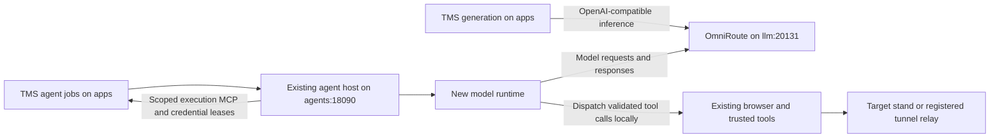

# Provider-neutral agent host with OmniRoute inference

Status: draft for owner approval; implementation and production cutover have not started.
Date: 2026-11-03.

## Requirement and decision

The owner requested OmniRoute and model `cx/gpt-6.1-sol-medium` across TMS, including browser execution, autotest authoring, and repair. The owner clarified that the existing harness should be reused as much as possible and that OmniRoute is exclusively the LLM provider.

The owner also requested retiring the Anthropic SDK runtime: log out, clear or reset its authentication/cache state, and stop it. Schedule this after the new route passes acceptance, because TMS currently depends on that runtime. Keep the shared harness, browser/tool infrastructure, TMS data, and usage journal intact.

Extend the existing executor on `gigglin-agents` with an OpenAI-compatible model runtime. Reuse its supervisor, session API, browser, trusted tools, credential handoff, event journal, cancellation, and accounting contract. OmniRoute supplies inference; it does not run the browser, host MCP tools, redeem stand credentials, or orchestrate TMS jobs.

The proposed SDK choice and configuration spelling below are implementation recommendations, not additional owner requirements.

## Evidence checked

- TMS backend and worker currently run `ai-testcase-generator-backend:claude-host-657025a8` on `gigglin-apps` (`10.10.30.10`). A private Compose override selects `LLM_BACKEND=claude-host` for both services.
- The existing host runs on `gigglin-agents` (`10.10.50.10:18090`). Deployed host source is release `32f19d3`; its source and deployment changes exist on the `My_server` branch `codex/claude-sdk-host`, whose observed tip is `8dc2f32`.
- The current contour branch contains the network override but not the complete executor source tree. Implementation must integrate the relevant host source without reverting the newer Proxmox/VLAN topology or the pending backup repair.
- The host's `RunSpec`/`RuntimeEvent` boundary and worker NDJSON protocol already separate session supervision from the Claude-specific runner. `SessionTools` combines reusable tool lifecycle with Claude SDK registration glue; that glue needs separation.
- The host worker unconditionally checks for Claude authentication today. That check must become runtime-specific.
- TMS has one system AI settings row, no team AI settings rows, and no user AI settings rows. The saved system URL is the obsolete Docker address `http://omniroute:20129/v1`.
- The supplied key successfully accessed `http://10.10.60.10:20131/v1/models`; its catalog includes the exact requested model. No live inference or tool-call compatibility has yet been established.
- `gigglin-agents` reports approximately 2.4 GiB RAM and 1.5 GiB available at inspection. Begin with the existing shared one-session concurrency limit, not a second simultaneous browser service.

## Approaches

1. Extend the existing executor with another runtime and share its lifecycle/tool infrastructure. This best matches the owner's maximum-reuse clarification and avoids a second browser stack. Chosen direction.
2. Deploy a separate independent harness. This permits separate upgrades, but duplicates lifecycle and tool integration. The owner requested reuse rather than this duplication.

Do not route GPT through the Claude SDK or replace its authentication endpoint. The new runtime calls the OpenAI-compatible gateway directly from the existing executor's controlled network namespace.

## Responsibilities and data flow

- **TMS:** owns authorization, task prompts, jobs, stand leases, persistent encrypted credentials, run results, evidence, retries, repair composition, and deterministic test checks.
- **Agent host:** owns model turns, tool dispatch, local browser sessions, temporary secret state, session supervision, cancellation, deadlines, and replayable usage events.
- **OmniRoute:** receives model requests and returns model output, tool-call requests, and usage. Function descriptions and redacted observations travel as ordinary model context. Actual tool handlers remain in the host/TMS, and the host validates and executes requested calls.

## Host implementation boundary

### Runtime selection

- Add an operator-controlled route from an allowed model alias to its runtime, upstream model ID, internal base URL, and secret file. Caller input may select an allowed alias, never an arbitrary endpoint, key, runtime option, or tool capability.
- Register `cx/gpt-6.1-sol-medium` with the OmniRoute runtime and upstream model ID of exactly the same value. Preserve the old Claude route during verification. After successful cutover, check existing consumers, drain Claude sessions, and disable the Claude routes/runtime as part of the owner's retirement request.
- Both runtimes consume the existing `RunSpec` semantics and emit the existing `RuntimeEvent` semantics. The supervisor, event receipts, idempotency keys, session endpoints, and TMS transport contract remain shared.
- Claude OAuth readiness applies only to Claude routes. OmniRoute routes require their configured API key and gateway connectivity, and must work when Claude OAuth is absent or expired. No automatic cross-provider fallback.

### Model loop

- Recommended implementation: a pinned OpenAI Agents SDK runtime using its OpenAI-compatible Chat Completions adapter. Use a custom client with the internal gateway URL and secret-file key; explicitly select the requested model.
- Disable SDK tracing and external exporters before the first run. Keep the host's existing local operational events and counters.
- Perform a minimal real compatibility probe before committing to this SDK adapter: text completion, streamed output and usage, one function call, its tool-result continuation, and cancellation. Verify the gateway's actual behavior rather than assuming that model discovery proves compatibility.
- If the probe reveals an SDK/gateway mismatch, document it before changing runtime libraries or protocol. Do not silently substitute a different model or a direct provider endpoint.
- Completion profiles remain tool-free and bounded to one model turn. Execution and authoring profiles use only their existing allowed tools.

### Tool reuse

- Separate provider-neutral tool lifecycle and dispatch from the Claude-specific MCP registration functions in `SessionTools`. Preserve the old Claude registration adapter.
- Reuse `BrowserSession`, `BrowserToolkit`, named-value typing, grant checks, evidence sink, tunnel mapping, and source submission/refusal rules.
- Map only the registered tool schemas into model function definitions. Validate tool names and arguments on every call. Preserve the execution profile's five TMS MCP tools and the distinct execution/authoring browser tool lists.
- External MCP stays an authenticated host-to-TMS connection, with exact registered endpoint and tool allowlists. Keep transport credentials outside model-visible messages.
- A returned tool call requests local execution. OmniRoute never becomes a tool server or gains direct stand/browser access.
- Keep screenshots/evidence on the existing trusted upload path. Accepted authoring source comes only from `submit_test`, never from final assistant prose.
- Execute state-changing tool calls sequentially within a session; do not introduce parallel browser actions merely because a model returns multiple calls.

### Lifecycle and usage

- Preserve the existing process-per-session cleanup, deadlines, maximum turns, bounded queue, five-second grant/consumer checks, and thirty-second consumer lease.
- Cancellation stops the active upstream request and prevents subsequent tool dispatch. Retain the supervisor's bounded termination path and explicit incomplete accounting after an interrupted provider response.
- Normalize OpenAI-compatible prompt/completion/cache counters into the existing host event fields. Count reasoning tokens as part of completion tokens when the upstream already includes them; do not add them twice.
- For agent budgets, count uncached input plus output; cached input is excluded only when explicitly reported by the provider. If no cache breakdown is supplied, treat prompt tokens as uncached. Completion totals retain all prompt tokens.
- Emit positive usage deltas exactly once per model turn and preserve atomic TMS receipt/ACK behavior. Never pass OpenAI counters through the Claude-specific `UsageMeter` parser unchanged.
- Preserve replay behavior, authoring submission acknowledgment, interrupted-session semantics, and the prohibition on automatic replay of side-effecting jobs.

## Network and secrets

- Host inference goes to `10.10.60.10:20131` over the existing agents-to-llm contour rule. Permit exactly that peer/port in the executor namespace policy and direct internal bypass configuration. The router rule alone does not make the destination reachable through the host's namespace firewall.
- Keep browser/external-resource traffic on the agents contour's existing strict Kazakhstan proxy policy. Internal inference must not be sent through that external proxy, and gateway failure must not enable direct provider calls.
- Retain the existing `10.10.50.10:18090` host entry point and existing TMS credential/MCP registrations. No new public port or general inter-contour access is planned.
- The supplied key is saved at `/home/gigglin/.config/tms-omniroute/api-key` on `gigglin-apps`, mode `0600`, outside Git. During deployment, securely provision a separate read-only host secret file on `gigglin-agents`; never place its value in Compose, source, prompts, logs, or command arguments.
- Keep stand secrets in the existing session-only trusted store. Model context continues to receive named placeholders and redacted observations.

## TMS cutover

1. Build and verify the host extension independently while TMS retains its current working route.
2. Add the provider-neutral `agent-host` selector as an additive alias for the existing host adapters. Preserve `claude-host` compatibility and the deployed environment names while avoiding a broad rename of persistent grant/receipt fields or internal routes.
3. Set generation to `LLM_BACKEND=api`. Set backend and worker `AI_BASE_URL=http://10.10.60.10:20131/v1` and `AI_MODEL=cx/gpt-6.1-sol-medium`, with the validated key loaded from server-only configuration.
4. Update persisted system, team, and user AI overrides so every effective generation configuration resolves to that URL/model/key at cutover. Preserve the normal settings hierarchy and existing authorization rules; do not change historical session content or usage records.
5. Set `LLM_AGENT_BACKEND=agent-host` and `LLM_AGENT_HOST_MODEL=cx/gpt-6.1-sol-medium`, keeping the existing private host URL and application/provider identities. Agent execution, authoring, and repair select the new runtime through this registered alias.
6. Preserve the current creator allowlist and project permissions. This task changes model routing, not who may run agents.
7. Drain active generation/agent jobs before restarting backend/worker or the host. Keep versioned images and private configuration backups for rollback; preserve all volumes, authentication state, journals, and results.
8. Copy successful non-secret deployment changes into the repository and verify deployed/source equality. Never copy operational `.env` or secret files into Git.
9. After acceptance, use the supported Claude logout operation, clear only Claude authentication/cache state, and verify that no Claude SDK child/session remains active. Disable further Claude runtime starts while keeping the shared agent host and tools running. Preserve TMS records, evidence, stand secrets, and the host event journal. A later rollback to Claude will require a new official login after logout; do not describe it as an immediately authenticated fallback.

## Verification and acceptance

Use the executor and TMS's existing suites plus bounded operator probes. This infrastructure task does not add a new browser regression suite or an unrelated automated test suite. Do not send TMS feature docs to the generator unless the owner separately requests it.

| Gate | Required evidence |
| --- | --- |
| Gateway contract | Exact requested model completes text and a function-call/tool-result round trip through the internal URL; streaming and usage are usable by the chosen adapter. |
| Reuse | Both runtimes invoke the same browser, grant, evidence, tunnel, and submission logic during migration; Claude remains functional until the new route passes acceptance. |
| Runtime independence | The OmniRoute route works without Claude OAuth; an unknown model alias or failed gateway does not choose another provider. |
| Boundaries | Tools execute on the host/TMS. Named credentials stay out of model requests and logs; an undeclared tool, inactive grant, wrong origin, or unregistered MCP target is denied. |
| Lifecycle | Cancellation, deadline, budget exhaustion, reconnect, duplicate receipts, and host interruption preserve existing terminal and accounting behavior. |
| Network | Internal gateway traffic succeeds from the guarded runtime; direct provider access remains blocked; browser external traffic retains the strict proxy exit. |
| TMS generation | Effective configuration for each current user resolves to the requested URL/model; a throwaway generation completes and records the correct model and usage. |
| Browser execution | A bounded pilot run against an owner-approved safe stand performs a real tool action and records evidence/results. |
| Authoring and repair | A pilot source is submitted through `submit_test` and passes TMS's existing deterministic checks; repair retains its browser-then-rewrite sequence. |
| Operations | Readiness, cleanup, shared one-session capacity, rollback, and server/repository synchronization are verified before declaring full cutover complete. |
| Claude retirement | After acceptance, Claude logout succeeds, targeted authentication/cache state is cleared, no Claude SDK child remains active, and new Claude sessions are disabled while the shared host and OmniRoute route stay healthy. |

A model listing or successful text completion alone does not establish agent execution, authoring, or repair acceptance. Select a safe pilot stand through existing TMS configuration during implementation; if none is available, report that specific acceptance gap rather than claim full operation.

## Scope left to the builder

- Exact additive configuration field names, module layout, and pinned SDK version, after the gateway compatibility probe.
- Minimal source integration from `codex/claude-sdk-host` into an isolated implementation branch while preserving the authoritative current contour configuration.
- Existing-suite commands and bounded probes appropriate to the final diff; no new feature, permission model, workflow engine, service database, or UI is implied.

## Reference

- OpenAI Agents SDK models and providers: <https://developers.openai.com/api/docs/guides/agents/models>.
- Existing host design and API: `docs/superpowers/specs/2026-10-27-claude-sdk-host-design.md` and `claude-sdk-host/API.md` on `codex/claude-sdk-host`.
